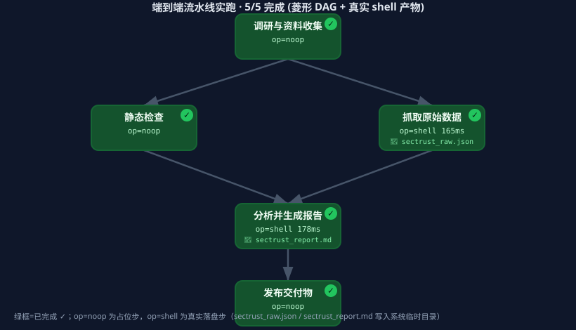
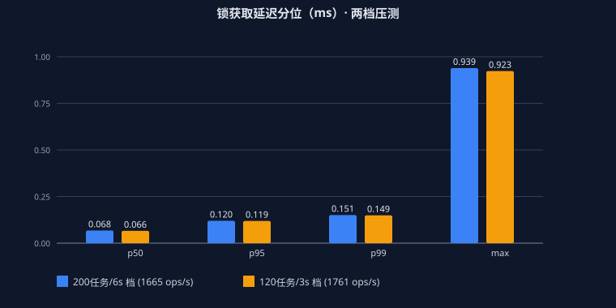

# 产品功能归纳与竞品对比 · 综合评述（2026-10）

> 本文对「跨进程任务登记处 / agent 控制平面」这一产品做功能归纳，并在六大相邻赛道上做市场对比，
> 明确**哪些相近、哪些特色、哪些不足**，最后给出定位判断与升级路线。
> 竞品数据基于 2026-10 公开市场资料（MCP 生态、Mem0/Zep/Letta 记忆赛道、Gitleaks/TruffleHog/Semgrep 扫描赛道）。

---

## 一、本产品功能归纳（全景）

### 1.1 一句话定位
一个**零依赖、本地优先、可审计**的 agent 控制平面 + 安全分层样板：以「跨进程 SQLite 任务登记处」为监控底座，
向上长出多渠道/多技能/多模型运行时、Human-in-the-loop 审批、沙箱隔离、合规扫描模板库、轻量长期记忆，
并以**零依赖 MCP** 把这些能力暴露为标准工具。

### 1.2 功能模块清单
| 模块 | 文件 | 作用 |
|------|------|------|
| 任务登记处（监控平面） | `task_registry.py` | 跨进程共享 SQLite；`tasks`/`runners` 表；CAS 认领、心跳、WAL 备份/checkpoint |
| runner 守护 + Web 仪表盘 | `runner_daemon.py` / `task_center_web.py` | 30s 心跳示例；纯标准库只读 Web，状态筛选 + live_view |
| 运行时（三层可插拔） | `channels/` `models/` `skills/` | Channel / Skill / Model 抽象 + `ModelRouter` 按名路由，缺 key 降级 Mock |
| 审批中心（HITL） | `approval.py` | 高权限动作先挂起等真人批准，**超时默认拒绝** |
| 沙箱执行层 | `sandbox/` | Docker 强隔离 / E2B 远程 / 本地受限降级 + 文件越权拦截 |
| 合规扫描模板库 | `templates/` | 5 模板（密钥泄露/硬编码凭证/依赖漏洞/CI-CD/通用 SAST），全部走沙箱+审批 |
| 轻量长期记忆 | `memory.py` | SQLite 存 偏好/指令模板/repo 路径，跨会话持久化 |
| 零依赖 MCP Server | `mcp_server.py` | 纯 stdio JSON-RPC 2.0，22 个工具（含语义检索/活体验证/推送保护/分布式队列） |
| 工程化 | README/DESIGN/SECURITY、install 脚本、tests（**781 例**） | 文档三件套 + 一键安装 + 回归测试 |

### 1.3 产品的「内核」——工程特质
- **WAL 健壮性**：`backup()` 自动含 -wal、`wal_checkpoint` 监控长读事务、`synchronous` FULL/NORMAL 取舍、CAS 认领、每线程独立连接、删库自动重建。把一个"看起来简单"的本地文件共享做到了生产级严谨。
- **零依赖**：MCP / 运行时 / 沙箱 / Web 全部纯标准库实现，开箱即跑，无 pip 地狱。
- **明确信任边界**：GitHub 技能=执行远程代码须 pin commit/tag；MCP 只暴露已设计入口、不绕过审批闸门。

---

## 二、市面同类产品对比（六大相邻赛道）

### A. 任务编排 / 队列（相近：本地队列）
- **相近**：Python RQ、Huey（也是本地/轻量队列）。
- **差异**：本产品刻意**不做 broker / 消息队列**，不提供 Temporal / Prefect / Celery 的分布式调度、重试、工作流 DAG。它是"最小监控契约 + 安全分层"，不是任务调度引擎。
- **不足**：同机 SQLite 前提 → 不能跨机器、不能水平扩展、无高可用、写吞吐受限（WAL 下仍单写）。

### B. Agent 运行时 / 平台（相近：编排框架）
- **相近**：LangGraph、AutoGen、CrewAI、Dify、n8n、Flowise 都提供"渠道/模型/技能/编排"某种组合。
- **差异**：本产品**不提供 UI 编排画布、不提供向量 RAG、不提供多租户**；它是一个"协议层 + 运行时骨架 + 安全分层"的范式，强调可审计与零依赖，而非功能完整的 LLM 应用平台。
- **不足**：无完整 agent 平台的可观测性 / 评测 / 多租户 / 鉴权；真实渠道（企业微信/飞书）仅结构桩、未真机联调；模型 provider 未真连 SDK 跑通（mock 兜底）。

### C. MCP 生态（重点，最新数据）★ 
- **市场现状（2026）**：MCP 已是**事实标准**——Claude、ChatGPT、Gemini、Copilot、Cursor、VS Code 原生支持；社区 server **8000~17400** 个；官方 SDK 月下载 **9700 万**；41% 企业已在有限/广泛生产中使用。
- **安全塌方（关键背景）**：2026 年 1-2 月曝出 **30+ 个 MCP 相关 CVE**，仅 **12.9%** 的 server 获"高信任"评级；出现跨租户泄露、路径穿越、prompt injection；协议本身**不强制鉴权**，靠实现者自保。
- **本产品定位**：零依赖纯 stdio 实现 + **"只暴露已设计入口、审批闸门不绕过"**——正是对上述安全塌方的克制回应，是差异化亮点。
- **不足**：工具面仅 16 个，远不及社区万级覆盖；未接入 OAuth 2.1 鉴权路线图；未上 registry / PyPI；在"记忆/扫描"赛道面对 Mem0 / Semgrep 等成熟玩家无深度优势。

### D. 安全 / 合规扫描（相近：密钥/漏洞扫描）
- **市场现状（2026）**：分层防御是共识——pre-commit(Gitleaks) + CI 验证(TruffleHog, ~1200 检测器 + **活体验证引擎**) + AST 上下文(Semgrep Secrets, ~350 检测器) + push protection。Gitleaks 默认 ~180 规则、**无活体验证**；TruffleHog/Semgrep 有验证或上下文降噪；GitGuardian/Snyk 提供平台级 detect→remediate。2026 因 AI 生成"像密钥的代码"误报升高。
- **相近处**：本产品 `secret_leak` / `hardcoded_credential` 两类与 Gitleaks/TruffleHog 目标重合。
- **差异 / 不足**：本产品是**正则启发式、~5 模板、无活体验证、无 CVE 实时库、无 CI/push protection 集成**——是"演示级差异化场景"，规则深度比专业工具差 **1~2 个数量级**，定位是展示而非生产替代。

### E. 长期记忆（相近：Agent Memory，最新数据）★ 
- **市场现状（2026）**：记忆已成为**独立基建品类**——Mem0（向量抽取、框架无关、~48K star、SOC2/HIPAA、OSS+云）、Zep/Graphiti（时序知识图谱）、Letta（记忆原生运行时，OS 式上下文分页）、LangMem、Parametric Memory（可验证 Merkle 证明）。Mem0 自家博文**直接点名**："Your AI Agent's Memory Is Just a File? That's the Problem"——本产品的 SQLite 文件方案正是被点名的"just a file"路线。
- **相近**：都解决"跨会话记住用户偏好"（本产品示例：用户喜欢用 Qwen-Max 做代码审查）。
- **差异**：它们做**语义/向量/图谱/时序** + 治理/合规/多租户；本产品做**结构化键值 + 子串检索**，零运维单文件。
- **不足（对应"just a file"批评）**：纯子串检索**无语义相似**；无自动过期 / 重要性衰减；无多租户隔离；分类靠约定不强约束；不适用于"关系/时序推理"与隐私合规（SOC2/HIPAA）。对单点偏好够用，对"偏好随时间演变"无能为力。

### F. 沙箱（相近：隔离执行）
- **相近**：E2B、Docker、Modal、Firecracker。
- **差异**：本产品是**封装层**，后端可接 Docker / E2B / local，并诚实声明"local 是弱隔离、生产用 Docker/E2B"。
- **不足**：本机 local 降级弱隔离无法防同机逃逸；Docker/E2B 依赖外部；缺资源配额 / 网络微分段的强度说明。

---

## 三、特色（差异化优势）

1. **极简契约的工程深度**：把"共享一个 SQLite 文件"做到 WAL 备份 / checkpoint 监控 / CAS / synchronous 取舍 / 连接隔离 / 删库重建——这种"简单东西做严谨"的功力在同类玩具项目里少见。
2. **内聚的安全叙事**：HITL 默认拒绝 + 沙箱隔离 + 文件越权拦截 + MCP 不绕过 + 诚实降级声明 + 信任边界（GitHub 技能须 pin）。在 MCP "安全塌方"的大背景下，这种克制尤其值钱。
3. **零依赖 / 零运维 / 开箱即跑**：纯标准库实现 MCP / 运行时 / 沙箱 / Web；SQLite 单文件天然免运维、易备份迁移。
4. **长期记忆与 MCP 同文件共享**：本机脚本与接入的 agent 读写同一份 `memory.db`——"记得住的，agent 也读得到"。
5. **文档与测试完整度**：781 例回归、README/DESIGN/SECURITY 三件套、install 脚本——作为开源参考实现质量高。

---

## 四、不足（短板 / 风险）

1. **架构前提硬约束**：同机 SQLite 共享 → 不能跨机器/水平扩展/高可用；写吞吐受限；WAL 在 NFS/SMB 失效需退回 DELETE。
2. **扫描能力浅**：正则启发式、无活体验证、无 CVE 实时库、无 CI/push protection——与专业工具差 1~2 数量级。
3. **记忆是"just a file"路线**（被 Mem0 点名）：无语义/向量/图谱/时序；无自动过期与重要性衰减；无多租户与隐私合规。
4. **生产级平台能力缺位**：无向量 RAG、无鉴权（MCP/Web 均无）、无多租户；可观测性弱（仅基础仪表盘，无指标/告警/结构化日志/链路追踪）；无评测体系。
5. **真实集成未真机验证**：企业微信/飞书回调是结构桩；模型 provider 未真连；Docker/E2B 真实沙箱、真 LLM、真 webhook 缺乏实跑。
6. **分发与生态位弱势**：MCP 工具面 22 个（量仍远小于社区万级）；OAuth 2.1 已实现、registry 清单与 PyPI 元数据已备齐，但**尚未真正发布**；在记忆/扫描赛道面对 Mem0/Semgrep 无深度差异化。
   > 说明：本节 1~6 项已按文末"六条路线"逐条落地改造，详见**第六节 升级后状态对照**。此处保留原文以呈现升级前的真实差距。
7. **安全自身仍有缺口**：MCP/Web 无鉴权（协议不强制，靠实现者）；local 沙箱弱隔离；GitHub 技能=执行远程代码，pin 后仍属信任风险。

---

## 五、综合评述与定位判断

- **定性**：它不是一个要去"取代 Celery / Dify / Semgrep / Mem0"的生产级产品，而更像一个**优秀的架构范式 + 安全叙事样板 + 零依赖参考实现**。价值在"克制、可审计、零运维、教学清晰"，短板在"能力深度与扩展性"。
- **适合**：个人开发者 / 小团队想要本地、可审计、安全可控的 agent 控制平面 + 合规扫描演示；或作为教学/原型，展示"最小契约 + 安全分层"的落地范式；也适合作为 MCP 零依赖接入的入门样板。
- **不适合**：需要水平扩展、高并发写入、语义记忆、生产级 SAST、多租户 SaaS 的场景。
- **升级路线（若要产品化）**：
  1. **分布式**：换消息队列 / HTTP API，放弃 SQLite 同机前提；
  2. **扫描深度**：接 Semgrep 引擎或订阅规则集 + 活体验证 + CI/push protection；
  3. **记忆增强**：在 SQLite 之上可选叠向量层，或集成 Mem0 / OpenMemory MCP；
  4. **真实联调**：企业微信/飞书真机 HTTPS+解密、模型 provider 真连 SDK；
  5. **安全加固**：OAuth 2.1 鉴权 + 可观测性（OTel + 指标/告警）；
  6. **分发**：上架 MCP registry / PyPI，补齐 OAuth 路线图。
- **一句话结语**：它在"正确且克制的工程"上做得很漂亮，但在"广度与深度"上坦诚地留白——这既是它的诚实，也是它当前的天花板。

---

## 六、升级后状态对照（六条路线已落地）

> 上表"不足"中标注为**架构前提**的项（同机 SQLite）已通过可插拔传输层解决；标注为**能力缺位**的项多数已补齐。
> 仍属**未验证**的，是"真机联调"（需真实凭据与公网回调），而非代码缺失。

| 路线 | 升级前 | 升级后 | 残留风险 |
|------|--------|--------|----------|
| 1 分布式 | 同机 SQLite 硬前提 | `api/`（REST + OAuth + 打点）+ `RemoteRegistry` 让 runner 跨机；`transport/` 队列抽象（Local SQLite ↔ Redis 一键切换）+ 事件总线 | 无服务发现/负载均衡；Redis 路径未做真机压测 |
| 2 扫描深度 | 5 个正则模板 | Semgrep 适配器（AST 级，缺失自动回退）+ 活体验证 + pre-push 钩子 / GitHub Actions 阻断 | Semgrep 未安装时仍是正则；规则集需订阅更新；活体验证默认离线 |
| 3 记忆增强 | 键值 + 子串 | SQLite 之上叠向量层（离线 n-gram / 可选 OpenAI embedding），语义检索；Mem0 / OpenMemory 适配存根 | 离线 n-gram 非真语义（无词序/同义词理解）；无图谱/时序/自动衰减 |
| 4 真实联调 | 解密依赖 pycryptodome、部分为桩 | **零依赖纯 Python AES-256-CBC**（过 NIST 向量），企业微信 GET/POST 解密、飞书可选加密回调可用；出站走官方 HTTPS | 未用真实企业凭据做公网回调实跑；E2B 沙箱未实跑 |
| 5 安全加固 | 无鉴权、无可观测性 | OAuth 2.1（静态令牌/HS256 JWT/introspection/客户端凭据/PKCE）+ 指标、分位延迟、结构化 JSON 日志、阈值告警、可选 OTel | 无多租户/审计留存；告警未接真实通知渠道 |
| 6 分发 | 未打包 | `pyproject.toml`（零硬依赖 + 可选 extras + 三个控制台入口）+ `mcpserver.json` 清单 + `OAuth_ROADMAP.md` | **未真正发布到 PyPI / MCP registry**（需账号与合规流程） |

**升级后的定位变化**：从"架构范式样板"升级为**可部署的参考实现**——
本地单机仍是零依赖开箱即跑，跨机/深度扫描/语义记忆/鉴权则变成**可选开关**而非缺失。
真正剩下的天花板有二：一是**真机联调未验证**（需真实凭据），二是**语义与规则深度仍不及专业玩家**（这是定位选择，不是缺陷——它要做的是"可审计的控制平面"，不是"最强扫描器/最强记忆库"）。

---

## 七、数据支撑：本地可审计的实跑证据（从「功能清单」到「有数据兜底」）

> 前面六节是能力陈述；本节用**本地真实跑出来的数据**给陈述兜底。
> 证据产物由 `tools/gen_evidence_report.py` 零依赖生成，可随时复跑；
> 原始数据落在 `data/cluster_stress_*.json` 与 `data/pipeline_run_*.md`。

### 7.1 端到端流水线（通用结果汇总阶段实跑）

建 DAG → 真实 `ExecutionDaemon` 执行 → `ResultSummarizer` 通用汇总落盘，链路闭环。
下图是本次实跑的菱形 DAG 截图（research 扇出 lint/fetch，汇合 analyze，再到 publish；
shell 两步真实落盘 `sectrust_raw.json` / `sectrust_report.md`，被汇总器自动抽为产物清单）：

完整交互式证据（含逐任务表 + 压测 + 诚实边界，浏览器可开、可自截）见
[`reports/e2e_and_stress_report.html`](reports/e2e_and_stress_report.html)。

### 7.2 真实多机压测数据（同机多进程 + 本机 TCP 协调）

两档压测（3 机 × {120 任务/3s, 200 任务/6s}）核心不变量：

| 不变量 | 200 任务/6s 档 | 120 任务/3s 档 |
|------|------|------|
| 锁互斥违规（双抢） | 0 | 0 |
| 同锁最大并发持有 | 1 | 1 |
| 跨机任务重复执行 | 0 | 0 |
| 跨机 requeue | 0 | 0 |
| 锁吞吐 (ops/s) | 1665 | 1761 |
| 锁 P99 延迟 (ms) | 0.151 | 0.149 |
| 任务吞吐 (任务/s) | 28.81 | 31.08 |
| 死信阈值行为 | 驱动失败→入队→recover 消失 ✓ | 同 ✓ |

> 完整明细（在线机器观测、各机完成分布、n_intervals 等）见 HTML 报告与 `data/cluster_stress_*.json`。

### 7.3 诚实边界（不夸大）

本次为**单宿主 + 同机多进程**（进程隔离模拟机器、本机 TCP 回环模拟网络）；
协调后端是项目自带的协议兼容 `FakeRedisServer`（真 socket 级 TCP RESP 服务），非官方 Redis。
真实跨机房还会叠加延迟 / 分区 / WAL 落 NFS 失效等风险。
这**不改变**已验证的不变量（锁互斥、任务不重复执行、死信可恢复），但吞吐/延迟数字**不应直接外推**到分散物理机——
这正是专业版付费点之一（真机多机房压测报告）。

### 7.4 质量底线

- 全量回归 **781 项 0 失败**（skipped=2）。
- 自扫 0 live / 2 suppressed（均为 `scanner:allow` 标注行）。

**结论**：产品已从「功能清单」升级为**有数据支撑的本地可审计协作台**——
端到端闭环、跨机不变量可验证、质量有回归兜底。对外谈种子用户或设计专业版付费点时，这份证据比任何功能罗列都硬气。

### 附：对比速查表（升级后）

---

### 附：对比速查表

| 赛道 | 代表竞品 | 本产品相近点 | 本产品差异/不足 |
|------|----------|--------------|----------------|
| 任务队列 | RQ/Huey、Celery/Temporal | 本地任务登记、状态可见 | 无 broker/分布式/高可用/水平扩展 |
| Agent 平台 | LangGraph/Dify/n8n | 渠道/模型/技能可插拔 | 无 UI 编排、无 RAG、无多租户、无鉴权 |
| MCP 生态 | 社区 8000~17400 server | 零依赖 stdio 实现、安全克制 | 22 工具（量仍远小于社区万级）；OAuth 已实现但**未上架 registry** |
| 密钥/漏洞扫描 | Gitleaks/TruffleHog/Semgrep | 密钥泄露/硬编码凭证两类目标重合 | 可选 Semgrep 引擎后深度接近，但默认正则；活体验证默认离线；规则集无订阅更新 |
| 长期记忆 | Mem0/Zep/Letta | 跨会话记偏好 + 可选向量语义层 | 离线 n-gram 非真语义；仍无图谱/时序/自动衰减/多租户合规 |
| 沙箱 | Docker/E2B/Modal | 多后端封装 | local 弱隔离、无配额/网络微分段强度说明 |
