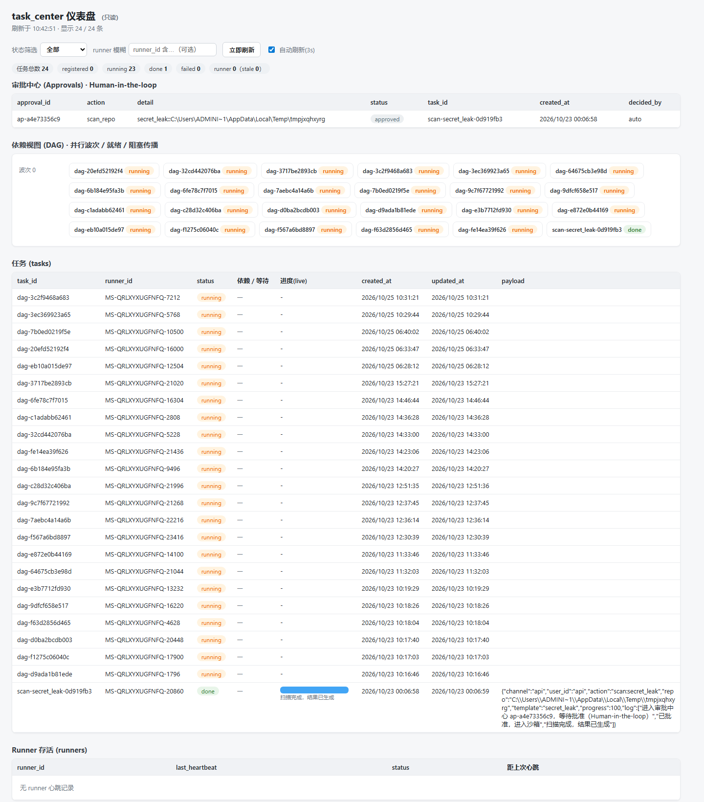

> [!WARNING]
> **实验性项目（v0.9.0-alpha）**：可运行、612 项测试全过的**原型**，未经过生产流量检验。
> 已在单机多进程场景验证；跨机分布式（Redis 后端）已实现但未实测。欢迎试用与提 issue，API 可能变动。

<div align="right">

**[English](README.md) | [简体中文](README.zh-CN.md)**

</div>

---

## ⚡ 5 分钟上手（Quickstart）

零依赖（纯 Python 标准库），Python ≥ 3.10 即可，无需 `pip install`：

```bash
git clone https://github.com/nanshandongli/SecTrust.git
cd SecTrust

python demo.py                                   # ① 核心契约自测（含真·跨进程并发）
python -m unittest discover -s tests -p "test_*.py"   # ② 全量 482 项测试
python task_center_web.py                        # ③ 浏览器打开 http://127.0.0.1:8090 看任务看板
```

**接入任意 MCP 宿主**（Claude Desktop / WorkBuddy 等）：

```json
{
  "mcpServers": {
    "sectrust": {
      "command": "python",
      "args": ["/absolute/path/to/SecTrust/mcp_server.py"]
    }
  }
}
```

40 个工具即刻可用：任务登记/认领、DAG 编排（`dag_*`）、质量回流、投票择优（`ballot_*`）、
合规扫描、长期记忆、审批查询、轨迹回放（`trace_*`）。详见下文与 [DESIGN.md](DESIGN.md)。

---

# SecTrust — AI 同事执行平台

一个**可审计、可常驻、多模型、多渠道**的 AI 同事执行平台。底层是「跨进程任务登记处」，向上长出
HITL 审批、沙箱隔离、合规扫描、长期记忆，并以零依赖 MCP / HTTP API 暴露为标准工具。

核心思路：两端在同一台机器上时，通过共享一个本地 SQLite 文件（WAL）交换任务元数据——这是「最小契约」，
也是零运维、事务可靠的内核。**若要跨机器**，已提供 HTTP API（`api/`）与可选消息队列（`transport/`），
runner 用 `--api-base` 即可把登记处/心跳写到远程中心，从而放弃同机前提（产品化路线 1）。

---

## 1. 目录结构

| 文件 | 作用 |
|------|------|
| `task_registry.py` | 核心契约：`TaskRegistry` 类，封装 `tasks` / `runners` 两张表与所有读写方法 |
| `runner_daemon.py` | 常驻 runner 守护示例（模拟收消息 + 30s 心跳循环 + 优雅退出） |
| `runner.py` | **多层运行时组合根**：渠道 + 模型 + 技能 接入登记处（见 DESIGN.md） |
| `config.py` | 配置加载（dataclass + 环境变量；密钥绝不硬编码） |
| `channels/` | 渠道适配层：`ChannelAdapter`(ABC) + `MockChannel` / `WeComChannel`(企业微信) / `FeishuChannel`(飞书) |
| `models/` | 多模型层：`ModelProvider`(ABC) + `ModelRouter` + `Mock` / `OpenAI 兼容` / `Anthropic` / `Ollama` |
| `skills/` | 技能层：`SkillProvider`(ABC) + `LocalSkillProvider` + `GitHubSkillProvider`(按 tag/commit 拉取) |
| `task_center_web.py` | task_center 只读 Web 仪表盘（纯标准库，含状态筛选） |
| `orchestration.py` | **编排层 · DAG 调度器**：任务依赖（`depends_on`）、就绪判定、并行波次、失败级联阻塞、并发安全认领 |
| `planner.py` | **编排层 · 需求拆解器**（规则模板版）：一句需求 → 带技能/质量规则的子任务 DAG，槽位抽不到不编造 |
| `arbiter.py` | **编排层 · 冲突仲裁**：多 AI 产出版本登记，默认人工裁，可选 recency/source_priority/evidence |
| `assets.py` | **编排层 · 素材库**：blake2b 内容寻址去重 + 版本链 + 任务关联 + 软删除 |
| `games/` | **多 AI 协同最小原型**：两人中国象棋（共享棋局表 + CAS 回合锁 + Broker 观战），验证底座可支撑多方博弈 |
| `execution/` | **执行层**：`workspace.py` 每 Bot 独立工作区（越权路径拒绝 + 状态原子写）+ `daemon.py` 常驻执行守护（认领→沙箱执行→审批门→complete/fail）+ `browser.py` 可编程浏览器（Edge CDP，手写 WebSocket 客户端；失败降级一次性 headless 批处理） |
| `scheduler.py` | **调度器**：纯标准库 cron 五段式 + interval，到期向登记处建任务（重启不重复触发；登记失败不推进） |
| `connectors/` | **连接器框架**：`base.py` 契约（未知 action 拒绝 / 未配置明确报错不返假数据）+ `github.py`（urllib REST）+ `imap.py`（邮件触发建任务，登记成功才标已读） |
| `proposal.py` | **主动提议循环（chief of staff）**：规则扫描停滞/未认领/审批积压/失败/挂起任务 → 提案进审批中心等人裁，**绝不自动执行**；冷却 + 未决双重去重；可选 LLM 摘要（缺 key 降级规则文本） |
| `threads.py` | **会话线程持久化**：thread + messages 落 SQLite，多端接续；`history` 取最近 N 条 + before 游标翻页 |
| `trace.py` | **轨迹回放层（Trace）**：每任务一条 trace_id 贯穿拆解/派单/执行/审批/质检/完成；结构化事件 + 摘要 + blake2b 内容指纹（原文与敏感字段不落库）；MCP 4 工具 + REST 回放端点 + CLI |
| `voice.py` | **语音输出**：复用 multimodal MediaRouter 合成 TTS（缺 key 明示 Mock 假音频）；渠道无语音能力时文本兜底附文件路径，不谎称已发语音 |
| `demo.py` | 5 条最小验收的自测脚本（含真·跨进程并发） |
| `DESIGN.md` | **多渠道/多技能/多模型 运行时扩展设计**（架构、信任边界、密钥管理） |
| `.env.example` | 全部环境变量清单（密钥只从环境变量读） |
| `tests/` | 单元测试（unittest；验收 + WAL 健壮性 + 运行时回归 + 象棋原型 + DAG 调度 + 编排层应用 + 执行层 + 消息框架 + 轨迹回放），共 **645** 例（全过） |
| `tools/self_audit.py` | **自检评测脚本**：从代码与运行时取证（功能清点/性能实测/扫描检出率/记忆/技能/证据门禁/安全穿透），输出 JSON |
| `SELF_AUDIT_REPORT.md` | **自检评测报告**：实测数据 + 竞品对比 + 评分卡（含发现并修复的 9 个真实缺陷：v1 的 3 个 + 深度轮 6 个） |
| `approval.py` | **审批中心（Human-in-the-loop）**：高权限动作先挂起等真人批准，超时默认拒绝 |
| `sandbox/` | **沙箱执行层**：Docker 强隔离 / E2B 远程 / 本地受限降级 + 文件越权拦截 |
| `examples/scan_repo_demo.py` | 最小可复现 Demo：`/scan repo` 全流程（审批→沙箱→live_view→回推） |
| `examples/sample_repo/` | Demo 用的本地样例仓库（离线扫描目标） |
| `install.sh` / `install.ps1` | 一键安装脚本（建目录、检查 Python/SQLite、探测 Docker/E2B 降级、生成 .env） |
| `SECURITY.md` | 安全设计白皮书（六大安全支柱、威胁模型、部署安全清单） |
| `data/` | 默认 SQLite 存放目录（首次运行自动创建；含 `task_registry.db` / `memory.db` / `mq.db`） |
| `memory.py` | **轻量长期记忆（P2）**：`MemoryStore` 类，SQLite 存用户偏好 / 常用指令模板 / 常用 repo 路径，跨会话持久化 |
| `memory_semantic.py` | **记忆增强（路线 3）**：在 SQLite 记忆之上可选叠向量层（离线 n-gram 余弦默认；可选 OpenAI/Mem0），语义检索 |
| `mem0_adapter.py` | Mem0 / OpenMemory MCP 集成存根（可用时把记忆委托给专业记忆层） |
| `mcp_server.py` | **零依赖 MCP Server（P0）**：JSON-RPC over stdio，暴露 40 个工具（登记处/审批/扫描/记忆/语义检索/活体验证/推送保护/分布式队列/DAG 编排/投票择优/轨迹回放） |
| `templates/` | **合规扫描模板库（P0）**：5 模板（密钥泄露/硬编码凭证/依赖漏洞/CI-CD/SAST）+ 执行编排（审批+沙箱双闸门） |
| `scanner/` | **扫描深度（路线 2）**：Semgrep 适配器（AST 级，可回退正则）/ 活体验证 / 推送前保护（git hook + CI yaml） |
| `api/` | **分布式入口（路线 1）**：`app.py` REST 服务（Bearer 鉴权 + 可观测性）+ `client.py` 远程客户端 |
| `transport/` | **消息队列（路线 1）**：`queue.py` 持久化 SQLite 队列（默认）/ Redis 适配 + `broker.py` 事件总线 |
| `security/` | **安全加固（路线 5）**：`crypto.py` 纯 Python AES-256-CBC（NIST 验证）/ `oauth.py` OAuth 2.1 / `observability.py` OTel + 指标告警 |
| `examples/memory_demo.py` | 长期记忆演示（写入→模拟下次会话召回→search/top_used） |
| `pyproject.toml` | **打包（路线 6）**：PyPI 元数据、可选 extras、控制台入口（api/runner/mcp） |
| `mcpserver.json` | **MCP registry 清单（路线 6）**：服务元数据、工具清单、能力声明 |
| `OAuth_ROADMAP.md` | **OAuth 2.1 落地路线图（路线 5/6）**：TLS / AS / PKCE / scopes / 多租户 / 审计 |

## 2. 契约字段（速查）

**tasks**
- `task_id` TEXT 主键
- `runner_id` TEXT 来源 runner 标识
- `status` TEXT：`registered` / `running` / `done` / `failed`
- `created_at` REAL / `updated_at` REAL：Unix 时间戳
- `payload` TEXT：JSON 字符串，任务元数据

**runners**（可选，心跳用）
- `runner_id` TEXT 主键
- `last_heartbeat` REAL：Unix 时间戳
- `status` TEXT：读取方按「超过 90s 无心跳」判定为 `stale`，否则 `alive`

主要方法：`register_task` / `update_task_status`（runner 侧）、`list_tasks`（task_center 侧）、`beat` / `list_runners`（心跳）。

## 3. 环境依赖

- **Python 3.10+**，核心代码**纯标准库，零第三方依赖**，无需 `pip install` 即可运行全部核心功能。
- 可选 extras（按需）：`mq`(redis) / `scan`(semgrep) / `memory`(mem0ai, sentence-transformers) /
  `observability`(opentelemetry) / `crypto`(pycryptodome 加速)。见 `pyproject.toml` 与 `pip install -e ".[mq,scan]"`。
- 操作系统：Windows / Linux / macOS 均可。同机部署共享 SQLite 文件；跨机部署走 HTTP API / Redis。

## 4. 启动方式

```bash
# 核心冒烟（单进程跑一遍契约）
python task_registry.py

# 5 条最小验收自测（含跨进程并发）
python demo.py

# 单元测试（任选其一，零依赖）
python -m unittest discover -s tests -v
python tests/test_registry.py
pytest tests/                 # 若已装 pytest

# 常驻 runner 守护（Ctrl+C 退出）
python runner_daemon.py --db-path data/task_registry.db
# 短跑测试（运行 N 秒后自动退出，便于验证）
python runner_daemon.py --db-path data/task_registry.db --task-interval 1 --heartbeat 2 --duration 7

# task_center Web 查看端（浏览器打开下面地址）
python task_center_web.py --db-path data/task_registry.db --port 8090
# 默认 http://127.0.0.1:8090/ ，支持按状态筛选、runner 模糊过滤、3s 自动刷新
```

看板实跑截图（Edge 无头模式拍摄，真实数据）：



## 5. 部署注意事项（接手必读）

1. **WAL 模式与网络共享**：代码默认开启 WAL 日志 + `busy_timeout=30s`，在**本地磁盘**上并发读多写少表现最好。
   若 `data/` 目录挂在 **NFS / SMB 等网络共享**上，WAL 可能失效或报错——此时应退回默认 DELETE 日志（去掉 `PRAGMA journal_mode=WAL;`），
   仅靠 `busy_timeout` 兜底重试。**不要在远端共享上强开 WAL。**

2. **路径解析坑（Windows 特别）**：Git Bash 的 `/tmp` 与 Windows Python 对 `/tmp/...` 的解析**不一致**，
   直接传 `/tmp/xxx.db` 会让写入方和读取方落到不同文件（开到空库）。**统一用 Windows 绝对路径或 `tempfile.mkdtemp()`**，不要图省事用 `/tmp` 简写。

3. **连接隔离（并发安全基石）**：每个进程/线程各自持有一条独立连接，**绝不跨进程共享连接对象**；
   打开即 `timeout=30`。不要为了「省连接」而把同一连接对象传给多进程——这是「database is locked」和脏数据的根源。

4. **删库自动重建**：任一连接建立时都会 `CREATE TABLE IF NOT EXISTS`，所以删除 `*.db`（连同 `-wal`/`-shm`）后，
   第一个写入方会自动重建表，无需手工初始化。

5. **安全边界**：
   - 登记处只存任务元数据，**不存 Token / 密钥等敏感信息**；
   - 查看端口（默认 8090）只暴露**只读**查询（`list_tasks` / `list_runners`），登记处 SQLite 文件本身不被网络直接暴露；
   - 默认绑定 `127.0.0.1`，如需局域网访问再改 `--host 0.0.0.0`（务必配合防火墙）。

6. **runner_id**：默认 `make_runner_id()` = `socket.gethostname() + "-" + os.getpid()`，可读且能区分同机多进程；
   也可用 `--` 启动时指定或自配，只要保证唯一可追溯即可。

## 6. 接手者工作流

- 改 `task_registry.py` 后，**先跑 `python -m unittest discover -s tests`** 防回归；
- 新增任务状态值时，记得同步更新 `task_center_web.py` 里的**状态筛选下拉项**和**徽章样式**（`.b-<status>`）；
- 性能/并发相关问题优先查：是否误共享了连接、是否在非本地盘强开了 WAL、是否把写操作放进了热循环。

## 7. 最小验收清单（demo.py / tests 均覆盖）

1. runner 收到 mock 消息后，登记处出现对应任务记录；
2. task_center 能查到该任务；
3. 任务状态变更后，task_center 能看到最新状态；
4. 两个进程同时读写不报错（demo 用 4 writer + 1 reader 真并发验证）；
5. 删除登记处文件后，runner 能重建表。

## 8. WAL 运维与健壮性（已增强）

针对 WAL 模式最容易踩的坑，已在 `task_registry.py` 落地以下能力（均有 `tests/` 覆盖）：

### 8.1 备份策略（WAL 副文件不能漏）
- **绝不能只复制主库文件**：未 checkpoint 的数据在 `-wal` / `-shm` 里，只拷主文件会丢数据。
- 正确做法二选一：
  1. `reg.backup(dest_path)` —— 基于 sqlite3 内置 `backup()` API，自动把主库 + 未 checkpoint 的 WAL 合并成单一目标文件；
     CLI：`python task_registry.py --db-path data/task_registry.db --backup-to /backup/reg.db`
  2. 先 `reg.checkpoint("TRUNCATE")` 把 WAL 回收进主库，再整目录复制（含 `-wal`/`-shm`）；
     CLI：`python task_registry.py --db-path data/task_registry.db --checkpoint`

### 8.2 长读事务监控
- `reg.checkpoint("PASSIVE")` 返回 `(total_frames, ckpt_frames, status)` 三元组。`status != 0`（通常 1）即被阻塞，
  最大嫌疑是有 reader 挂着长读事务没释放，导致 WAL 无法收缩——这就是 WAL 下最常见的坑。
- 当前实现每个读写操作都是**短事务**（`with conn:` 用完即提交），不会长期占用读快照，天然规避长读问题。
  若日后接入长生命周期 reader，请定期跑 `PASSIVE` checkpoint 并监控返回值，且确保 reader 及时结束事务。
- 注意：查看端 `task_center_web.py` 保持**纯只读**，不在其中做 checkpoint（那是写操作），避免破坏只读边界；
  checkpoint 交给 runner 或独立维护脚本执行。

### 8.3 synchronous 取舍
- 默认 `FULL`：极端断电也不丢已提交事务。
- 若可接受丢最近几秒、追求约 3x 写入吞吐，可在 WAL 下安全地用 `NORMAL`：
  构造 `TaskRegistry(synchronous="NORMAL")` 或 CLI `--synchronous NORMAL`。

### 8.4 任务认领（CAS，未来多 worker 抢单）
- `reg.claim_task(task_id, runner_id=None)` 执行
  `UPDATE ... SET status='running' WHERE task_id=? AND status='registered'`，
  靠影响行数判断谁抢到，返回 `True/False`，**无需分布式锁**。
- 多个 worker 并发认领同一任务时，只有一个能成功，其余拿到 `False`，可直接去认领其它任务。

### 8.5 数据目录权限
- `data/` 目录由代码自动 `makedirs` 创建；运行时需保证**所有相关进程的运行账户对该目录有读写权限**。
  多进程写入若报权限错误，先排查目录 ACL，而不是盲目调大 timeout。

### 8.6 多进程首开竞争的连接自愈（实测修复）
Windows 上多个进程**同时首次打开同一个新库**时，SQLite 可能给个别进程一条
"`connect` 成功、`PRAGMA journal_mode` 也返回 `wal`、但第一条写操作就报
`attempt to write a readonly database`" 的**半残连接**，且该连接之后**永不恢复**。
压测 8 进程时约 1/3 概率命中，表现为某些 worker 全程 0 成功。

`TaskRegistry` 的两层对策：
1. **建连探针**（`_open_conn`）：新建连接时用 `BEGIN IMMEDIATE` + `ROLLBACK`
   做一次廉价写探针，确认这条连接真能拿写锁；不健康就关掉重开（最多 5 次），
   仍失败则明确抛 `RuntimeError`——绝不把半残连接返回给调用方。
2. **写操作重试**（`_retry_write`）：探针挡不住"用着用着变坏"的连接（竞争窗口
   比探针长）。所有写操作失败后会丢弃连接、重建、再试一次。安全性依赖幂等性：
   `register_task` 是 `INSERT OR REPLACE`、`update_task_status`/`set_progress` 是
   `UPDATE`、`claim_task` 是 CAS（`status='registered'` 条件保证重试不会二次认领）、
   `beat` 是 `INSERT OR REPLACE`——重试一次不产生重复副作用。

验证：`tools/stress_test.py`（同机多进程基线）+ `tests/test_registry_selfheal.py`
（假连接注入故障，100% 稳定复现，不靠运气）。

---

## 9. 运行时扩展：多渠道 / 多技能 / 多模型

把「只会 mock 收消息的 runner」升级为多层 agent 运行时：`task_registry` 继续当**监控/控制平面**，
新增三层可插拔扩展点（详见 **DESIGN.md**）：

| 层 | 抽象 | 已落地实现 |
|----|------|-----------|
| 渠道 Channel | `ChannelAdapter` | `MockChannel`（离线）、`WeComChannel`（企业微信官方 API）、`FeishuChannel`（飞书官方 API） |
| 模型 Model | `ModelProvider` + `ModelRouter` | `Mock`（兜底）、`OpenAI 兼容`（通义/GLM/DeepSeek 等）、`Anthropic`、`Ollama`（本地） |
| 技能 Skill | `SkillProvider` | `LocalSkillProvider`（本地目录）、`GitHubSkillProvider`（按 tag/commit 拉取） |

**数据流**：渠道收消息 → `register_task` 写登记处 → 调模型推理 →（可选）执行技能 → `channel.send` 回消息 → `update_task_status` → 心跳。
任务中心的 `payload` 里自动带 `channel / model / skill / text`，Web 仪表盘照常可见。

### 9.1 启动命令
```bash
# 零配置离线端到端（mock 渠道 + mock 模型），最快验证整条链路
python runner.py --demo

# 接企业微信（凭据走环境变量，见 .env.example）
python runner.py --channel wecom --model gpt-4o-mini
# 接飞书
python runner.py --channel feishu --model claude-3-5-sonnet-latest
# 本地模型
python runner.py --channel mock --model ollama/llama3

# 监控仍用原 Web 仪表盘（只读）
python task_center_web.py --db-path data/task_registry.db --port 8090
```

### 9.2 加一个新渠道 / 新模型 / 新技能源
1. 实现对应 ABC（`ChannelAdapter` / `ModelProvider` / `SkillProvider`）；
2. 在 `runner.py` 的 `build_channel` / `build_model_router` / `build_skill_registry` 工厂里登记一行；
3. 跑 `python -m unittest discover -s tests` 防回归。

### 9.3 信任边界与安全
- **密钥**：全部走环境变量（`.env.example` 列全），代码不硬编码；缺 key 时模型自动降级 Mock，运行时不会崩。
- **GitHub 技能**：本质是加载并执行远程代码，**务必 pin 到具体 commit/tag**、只用可信仓库、配合 allowlist、尽量隔离环境运行（详见 DESIGN.md 3.3）。
- **真实渠道回调**：企业微信/飞书入站都做了签名校验结构，接手时按官方文档补全公网 HTTPS 与解密即可。

### 9.4 架构图

```
                         ┌──────────────────────────────────────────────┐
                         │            多渠道 / 多模型 / 多技能 运行时       │
                         │                                              │
   飞书 / 企业微信 / Discord ──►  ChannelAdapter (标准化 InboundMessage)   │
   (真实入口, 官方 API 回调)        │                                     │
                                  ▼                                      │
                          AgentRunner 组合根                              │
        ┌─────────────────────┤ ① register_task 写入登记处               │
        │                     │ ② 模型推理 (ModelRouter 多模型降级)       │
        │  高权限动作 ─────────┼─► ③ ApprovalCenter 挂起(pending)         │
        │  (/scan repo 等)     │        │ 真人批准 ─┐                      │
        │                     │        ▼          │                      │
        │                     │ ④ Sandbox 隔离执行 (Docker/E2B/本地降级)  │
        │                     │        │ 文件越权拦截 + 超时强杀           │
        │                     │        ▼          │                      │
        │                     │ ⑤ channel.send 回推结果 ◄────────────────┘
        │                     │ ⑥ update_task_status + set_progress         │
        └─────────────────────┴──────────────┬───────────────────────────┘
                                              │
                                              ▼
                         ┌──────────────────────────────────────────────┐
                         │  跨进程任务登记处 (task_registry)               │
                         │  SQLite + WAL 高并发；tasks / runners /       │
                         │  approvals 三张表；删库自动重建；备份含 WAL    │
                         └──────────────────────────────────────────────┘
                                              │ 只读
                                              ▼
                         ┌──────────────────────────────────────────────┐
                         │  task_center_web (只读仪表盘, 默认 127.0.0.1)  │
                         │  live_view 实时进度 + 审批中心待办 + 状态筛选  │
                         └──────────────────────────────────────────────┘
```

---

## 10. 安全能力（Human-in-the-loop + 沙箱）

本平台不是"更会聊天的 AI"，而是**更安全、可审计、可常驻的 AI 同事执行平台**。完整威胁模型与
缓解措施见 **[SECURITY.md](./SECURITY.md)**。核心支柱：

| 支柱 | 一句话 | 实现 |
|------|--------|------|
| Human-in-the-loop 审批 | 高权限动作先等人确认，超时默认拒绝 | `approval.py` |
| 沙箱隔离执行 | 危险动作只在容器/远程/受限环境跑 | `sandbox/` |
| 跨进程任务审计 | 所有动作经登记处留痕可回溯 | `task_registry.py` |
| 文件越权拦截 | 本地降级模式拦截跳出 jail 的访问 | `sandbox.LocalSandbox` |
| 多模型降级 | 缺 key/厂商不可用自动回落 Mock | `models.ModelRouter` |
| WAL 高并发登记处 | 同机多进程安全读写 | `task_registry.py` (WAL) |

**重要诚实声明**：`SandboxManager.auto()` 在无 Docker / E2B 时回退**本地受限降级**，它是弱隔离，
**仅用于可信低强度任务，切勿用来跑不可信代码**。生产务必上 Docker 或 E2B 强隔离。

---

## 11. 一键安装

```bash
# Linux / macOS / Git Bash / WSL
bash install.sh

# Windows PowerShell
powershell -ExecutionPolicy Bypass -File install.ps1
```

脚本会：检查 Python≥3.10 与 SQLite → 创建 `data/` ``.sandbox/`` → 探测 Docker/E2B 决定沙箱后端
（并打印降级提示）→ 从 `.env.example` 生成 `.env`（不覆盖已有）→ 冒烟检查核心模块 → 打印下一步命令。

---

## 12. 最小可复现 Demo（/scan repo，3 分钟）

演示链路：**飞书/Discord 发 `/scan repo` → 进入审批中心 → 批准后沙箱隔离扫描 → live_view 实时展示 → 结果回推 IM**。

```bash
# 终端 A：启动只读仪表盘（看实时进度与审批待办）
python task_center_web.py --db-path data/task_registry.db --port 8090
# 浏览器打开 http://127.0.0.1:8090/

# 终端 B：跑 Demo（默认 2 秒后自动批准，一键看完整流程；可加 --no-auto-approve 体验真人审批）
python examples/scan_repo_demo.py --auto-approve
```

真人审批版（不开自动批准，体验真正的 Human-in-the-loop）：
```bash
python examples/scan_repo_demo.py --no-auto-approve
# 另开终端：
python approval.py --list
python approval.py --approve <approval_id>
```

> 为离线可复现，Demo 默认扫描本地 `examples/sample_repo`（已复制进沙箱 jail 目录）。
> 生产环境替换为 `git clone <repo_url>` 到沙箱工作目录后再扫描即可。

---

## 13. 开源与社区（上架建议）

- **先开源，再上架**：建议先在 GitHub / Gitee 建公开仓库，带 README、架构图（本节 9.4）、启动命令、
  **常见问题（第 14 节）**、**WAL 备份说明（第 8 节）**、**降级策略（第 10 节）**——开发者社区非常看重这些。
- **目标人群**：开发者、安全合规团队、自动化团队、小企业主。本产品不是"随手下载的大众 Chat 类 AI"，
  但在"需要可审计、可常驻、保守权限的 AI 执行平台"场景有真实需求。
- **上架节奏**：先走开源 + 开发者社区 + 小范围试用；等飞书/GitHub 入口、一键安装、Demo 都补齐，再考虑上架应用市场。
- **差异化卖点**：当同类产品因默认权限过高被质疑时，本平台的"审批拦截 + 沙箱隔离 + 全程审计"保守设计即优势。

---

## 14. 常见问题（FAQ）

**Q1. 一定要同机吗？跨机器怎么办？**
A. 当前 SQLite 方案要求 runner 与 task_center 同机。跨机器需改为 HTTP API 或消息队列（不在本仓库，需另做）。

**Q2. 只复制 `.db` 文件做备份为什么丢数据？**
A. WAL 模式下未 checkpoint 的数据在 `-wal`/`-shm` 里。务必用 `backup()`（sqlite3.backup 自动合并）或先 `wal_checkpoint(TRUNCATE)` 再整目录复制。见第 8.1 节。

**Q3. 沙箱本地降级安全吗？**
A. **不安全（弱隔离）**，只用于可信低强度任务。生产请配 Docker（`docker run --network none`）或 E2B 远程沙箱。见 SECURITY.md。

**Q4. 没填 API key 会崩吗？**
A. 不会。模型层缺 key 自动降级到 Mock（`models.ModelRouter`），运行时照常跑；渠道/技能缺配置会回退 mock 或跳过 GitHub 源并打印提示。

**Q5. 审批超时了会怎样？**
A. `ApprovalCenter` 默认拒绝——超时未决自动 `expire`，**绝不默认放行**。这是"保守默认拒绝"的落地。

**Q6. 监控端口暴露到公网安全吗？**
A. 默认绑定 `127.0.0.1` 且只读（不暴露登记处文件本身）。如需局域网访问改 `--host 0.0.0.0` 务必配合防火墙。

**Q7. GitHub 拉取的技能能直接跑吗？**
A. 能，但本质是执行远程代码：**必须 pin commit/tag + 可信仓库 allowlist + 隔离环境**。见 DESIGN.md 3.3。

**Q8. Windows 上传 `/tmp/xxx.db` 为什么读不到数据？**
A. Git Bash 的 `/tmp` 与 Windows Python 路径解析不一致，会让读写双方落到不同文件。统一用 Windows 绝对路径或 `tempfile.mkdtemp()`。见第 5.2 节。

**Q9. 怎样让 Claude Code / Cursor / Open WebUI 调用我的产品？**
A. 直接用内置的零依赖 MCP Server：`python mcp_server.py`（默认走 stdio，监听 `data/task_registry.db`）。
   在客户端的 MCP 配置里指向它即可（参考仓库根 `.mcp.json`）。它把**审批中心、沙箱执行链、任务登记处**
   暴露成标准 MCP 工具，外部 agent 能发起扫描请求、查询任务/runner/审批，但**执行仍需审批闸门**（默认拒绝），不会绕过安全模型。

**Q10. 合规扫描模板怎么加？**
A. 在 `templates/builtin.py` 注册一个 `ScanTemplate(name, description, build_command(repo_dir), parse(text), severity)`：
   脚本写进 `templates/_scripts/<name>.py`（自动落盘、走沙箱），`parse` 把脚本的 JSON/文本产出抽成结构化结果。
   然后 `templates/__init__.py` 的 `request_scan / execute_scan / run_scan` 会自动带上新模板。

---

## 15. P0 生态入口：MCP Server + 合规扫描模板库

> 这两个组件让产品具备「**生态入口 + 差异化场景**」：任何支持 MCP 的客户端（Claude Code、Cursor、Open WebUI、Cline
> 等）都能直接调用你的产品；而合规扫描模板库切中开发者 / 安全团队的真痛点，是相对 OpenClaw / Hermes
> 的差异化场景。

### 15.1 MCP Server（`mcp_server.py`，零依赖）

纯标准库实现的 **JSON-RPC 2.0 over stdio** MCP 服务端（不依赖任何第三方 SDK）。暴露的标准工具：

| 工具 | 说明 |
|------|------|
| `list_templates` | 列出所有合规扫描模板（id / 描述 / 严重级别） |
| `request_scan` | 发起扫描请求：任务登记 + 进审批中心(**pending，默认拒绝**)，返回 task_id/approval_id |
| `approve` / `deny` | Human-in-the-loop 放行 / 拦截一个待审批请求 |
| `execute_scan` | 执行**已批准**的扫描（沙箱隔离）；未批准则拒绝 |
| `run_scan` | 一步式：`request_scan` +（可选 `auto_approve`）`execute_scan`，返回完整报告 |
| `list_tasks` / `get_task` | 读取任务登记处（只读） |
| `list_runners` | 读取 runner 存活（含 stale 判定） |
| `list_approvals` | 读取审批中心记录 |

> **安全要点**：MCP 工具与 Web 仪表盘一样**只暴露已设计的入口**。所有扫描都走「沙箱隔离 + 审批双闸门」，
> `request_scan` 默认不执行；`execute_scan` 内部强制校验审批状态，未批准一律拒绝。外部 agent 无法绕过安全模型。

启动（stdio，被 MCP 客户端拉起）：

```bash
python mcp_server.py                       # 默认 DB=data/task_registry.db
python mcp_server.py --db-path data/reg.db # 指定库
```

客户端配置示例（仓库根 `.mcp.json` 同款）：

```json
{
  "mcpServers": {
    "task-registry": {
      "command": "python",
      "args": ["mcp_server.py"],
      "env": { "DB_PATH": "data/task_registry.db" }
    }
  }
}
```

快速自测（脱离客户端，直接喂 JSON-RPC）：

```bash
printf '%s\n' \
  '{"jsonrpc":"2.0","id":1,"method":"initialize","params":{"protocolVersion":"2024-11-05","capabilities":{},"clientInfo":{"name":"t","version":"1"}}}' \
  '{"jsonrpc":"2.0","id":2,"method":"tools/list"}' \
  | python mcp_server.py
```

### 15.2 合规扫描模板库（`templates/`）

内置模板全部**走沙箱隔离 + 审批放行**，直接对标开发者 / 安全团队的日常痛点：

| 模板 id | 检测内容 | 严重级别 |
|---------|----------|----------|
| `secret_leak` | 泄漏的密钥 / 令牌（AWS、GitHub、私钥、Bearer 等） | high |
| `hardcoded_credential` | 硬编码凭证（DB 密码、明文口令、内联 token） | high |
| `dependency_vuln` | 依赖漏洞（解析 `package.json` / `requirements.txt` 比对已知弱版本） | high |
| `cicd_config` | CI/CD 配置风险（`pull_request_target` + `curl|sh`、`permissions: write-all` 等） | high |
| `generic_sast` | 通用静态扫描（TODO/FIXME、疑似密钥、代码行数统计） | low |

编排接口（与审批中心、沙箱、登记处打通）：

```python
from templates import list_templates, request_scan, execute_scan, run_scan

req   = request_scan("secret_leak", "/path/to/repo")          # 只登记 + 进审批
ok    = approval.decide(req["approval_id"], "approve")         # 人工放行
report= execute_scan(req["task_id"], req["approval_id"], "/path/to/repo")  # 沙箱跑
# 或一步式（auto_approve 仅限可信自动化）：
report= run_scan("secret_leak", "/path/to/repo", auto_approve=False)
```

离线演示（含样例仓库，含故意留下的假密钥 / 漏洞依赖 / 危险 CI）：

```bash
python examples/template_scan_demo.py --backend local --auto-approve
```

### 15.3 架构位置（新增于第 9 节图）

```
            ┌─────────────────────────────────────────────┐
            │  MCP 客户端 (Claude Code / Cursor / OpenWebUI) │
            └───────────────┬─────────────────────────────┘
                            │ stdio (JSON-RPC 2.0)
            ┌───────────────▼─────────────────────────────┐
            │  mcp_server.py  (P0 生态入口, 零依赖)          │
            │   暴露: list_templates/request_scan/approve/  │
            │        execute_scan/run_scan/list_tasks/...   │
            └───┬───────────┬───────────────┬──────────────┘
                │           │               │
        ┌───────▼───┐ ┌─────▼──────┐ ┌──────▼───────┐
        │审批中心     │ │ 沙箱执行链   │ │ 任务登记处    │
        │approval.py │ │ sandbox/    │ │ task_registry│
        └────────────┘ └────────────┘ └──────────────┘
                ▲ 合规扫描模板库 templates/ (secret_leak/hardcoded/dep/cicd/sast)
                └── 内置 5 个模板，全部走「沙箱 + 审批」双闸门
```

---

## 16. P2 轻量长期记忆（`memory.py`）

> 让产品「记得住用户」：跨会话记住**用户偏好、常用指令模板、常用 repo 路径**，例如
> 「这个用户喜欢用 **Qwen-Max** 做代码审查」。
>
> 设计取舍：**不引入向量库**。这类数据是「少量、结构化、可精确查」的——SQLite 的
> `(category, key)` 主键 + 子串检索 + 访问频次排序已足够；SQLite 零运维、事务可靠，
> 且与既有的 WAL 模式天然契合（备份 / 迁移 / 排查都简单）。

### 16.1 存储模型

单表 `memory_items`，与 `task_registry` 同一套工程约定（WAL + `busy_timeout(30s)` + `synchronous` + `threading.local` 连接隔离）：

| 字段 | 说明 |
|------|------|
| `category` | 分类（内置三类：`preference` 用户偏好 / `command` 常用指令模板 / `repo` 常用仓库路径；也允许任意自定义） |
| `key` | 分类内唯一标识，如 `code_review_model` |
| `value` | JSON 文本（字符串 / 数字 / 列表 / 字典皆可） |
| `note` | 人类可读说明（可选） |
| `created_at` / `updated_at` | 时间戳 |
| `access_count` / `last_accessed` | 访问统计，支撑「常用」排名 |

### 16.2 核心 API（`MemoryStore`）

```python
from memory import MemoryStore

mem = MemoryStore()                       # 默认 data/memory.db，复用 WAL
# 写 / 覆盖（value 任意 JSON 可序列化对象）
mem.remember_preference("code_review_model", "Qwen-Max", note="用户偏好的代码审查模型")
mem.remember_command("run_tests", "python -m unittest discover -s tests -v")
mem.remember_repo("this_project", "/abs/path")
# 读（不存在返回 None / 指定 default；touch 默认累加访问计数）
model = mem.recall_preference("code_review_model")        # => "Qwen-Max"
# 查
mem.list_category("command")            # 某分类全部
mem.search("审查")                       # key/note/value 子串检索（模糊回忆）
mem.top_used("command", n=5)            # 访问频次 Top N（常用指令模板）
mem.forget("preference", "old_key")     # 删除
mem.close()
```

**跨会话持久化**：数据落在磁盘 SQLite 上。进程退出后，下一次启动重新打开同一个
`MemoryStore()`（或另一个进程 / 外部 agent 通过 MCP 读写同一文件）即可读到上次写入的内容——无需任何额外服务。

### 16.3 通过 MCP 入口读写（生态复用）

记忆能力已作为标准 MCP 工具暴露，外部 agent（Claude Code / Cursor 等）也能跨会话读写：

| 工具 | 说明 |
|------|------|
| `memory_set` | 写入 / 覆盖一条记忆（category/key/value/note） |
| `memory_get` | 读取一条（不存在返回 null） |
| `memory_search` | 子串检索（按 category 过滤） |
| `memory_list` | 列出某分类全部 |
| `memory_top` | 访问频次 Top N（常用指令 / 常用 repo） |
| `memory_forget` | 删除一条 |
| `memory_semantic_search` | **语义检索**（向量层）：自然语言查询召回，如「代码审查用哪个模型」 |

> 记忆库与 MCP 共用 `data/memory.db`（env `MEMORY_DB_PATH` 可覆盖）；本地进程与 MCP 客户端写到的是同一份文件。
>
> **跨入口一致性**：记忆可能由 `MemoryStore`（或 MCP `memory_set`）直接写入，语义层当时不在场。
> `SemanticMemory` 在初始化与检索前会做廉价的「条目数比对」，把缺向量的条目自动补进索引，
> 因此「先写后查」「换入口写」都能被语义检索召回；换 embedding provider 后可调用 `reindex()` 全量重建。

#### 可选：接真 embedding provider（默认不启用）

默认走**内置哈希 n-gram 索引**（零依赖、跨进程可复现）。想用真向量只需设一个环境变量：

```bash
# 本地 Ollama（数据不出本机，需先 pull 好模型）
export EMBEDDING_PROVIDER=ollama
export OLLAMA_EMBED_MODEL=nomic-embed-text

# 或 OpenAI / 兼容端点
export EMBEDDING_PROVIDER=openai
export OPENAI_API_KEY=sk-...
```

设了即生效：MCP 的 `memory_semantic_search` / `memory_hybrid_search` 会自动切到真向量。
不设则维持哈希索引，行为与从前完全一致。

**换 provider 会自动重建全部向量**——因为向量空间变了（维度/桶位都不同），
旧向量与新查询不在同一空间，混算会得到静默错误的结果。相关约束：

| 场景 | 行为 |
|------|------|
| 换 provider / 换模型 | 版本键变化 → 全量 `reindex()`，旧向量重算 |
| provider 临时掉线 | **不写**异空间向量（宁可这轮不建向量，也不混存），记忆本体照常落库 |
| provider 恢复 | 版本键未变 → 无需重建，缺口由 backfill 自动补齐 |
| 维度不等 | 余弦直接判 0（不 zip 截断）——宁可漏召回，不给"半错的分数" |

### 16.4 离线演示与自测

```bash
# 演示：写入 → 模拟下次会话召回 → search / top_used
python examples/memory_demo.py

# 命令行自检
python memory.py --seed                       # 写入示例记忆
python memory.py --stats                       # 各分类条数
python memory.py --get preference code_review_model
python memory.py --search 审查
python memory.py --top command 5

# 全部回归测试
python -m unittest discover -s tests -v        # 含 tests/test_memory.py（16 例）
```

---

## 17. 产品化升级路线（已落地）

在「正确且克制的工程」基础上，按以下六条路线补齐产品化能力。**每条都已写出可工作、可测试的代码**，
并在 `tests/` 中覆盖。核心原则不变：**零依赖内核 + 可选 extras + 安全叙事一致**。

### 路线 1 · 分布式（放弃同机 SQLite 前提）
- `api/app.py`：把任务登记处 / 审批中心 / 记忆 / 扫描统一暴露为 **REST**（标准库 `http.server`，零依赖）。
- `api/client.py` + `RemoteRegistry`：runner 用 `--api-base <url>` 即可把登记处/心跳写到远程中心，跨机运行。
- `transport/`：`MessageQueue` 抽象 + `LocalQueue`（SQLite 持久化，默认，崩溃可恢复）+ `RedisQueue`（设 `REDIS_URL` 后自动切到 Redis，跨机）。
- `transport/broker.py`：事件总线，中心发布事件、runner/web 订阅驱动，无需轮询。

### 路线 2 · 扫描深度
- `scanner/semgrep_adapter.py`：探测并调用 **Semgrep**（AST 级，规则量远超正则）；不可用时自动回退正则引擎。
- `scanner/validators.py`：可插拔**活体验证**（默认离线 `unverified`；设 `LIVE_VALIDATION=1` 后真实校验 GitHub token 等）。
- `scanner/push_protection.py`：生成 **git pre-push 钩子** 与 **GitHub Actions workflow**，把泄露阻断在推送/合并之前。
- `templates.run_scan(engine="semgrep")`：一键升级为深度扫描，未装 semgrep 时优雅回退。

### 路线 3 · 记忆增强
- `memory_semantic.py`：**在 SQLite 记忆之上可选叠向量层**（离线默认 n-gram 余弦；可选 OpenAI embedding / Mem0）。
- `SemanticMemory.search_semantic(query)`：自然语言回忆（"代码审查用哪个模型"→ 命中 `code_review_model=Qwen-Max`），且**跨会话持久化**。
- `mem0_adapter.py`：可用时把记忆整体/可选委托给 **Mem0 / OpenMemory MCP**。

### 路线 4 · 真实联调
- `security/crypto.py`：**零依赖纯 Python AES-256-CBC**（已通过 NIST 向量），企业微信 GET echostr + POST 消息体解密、飞书可选加密回调均可用，**无需 pycryptodome**。
- 渠道出站（`send`）用标准库 `urllib` 直连官方 HTTPS（企业微信 / 飞书）；模型 provider 真连 OpenAI 兼容 / Anthropic / Ollama（Qwen、GLM、DeepSeek 走 `OPENAI_BASE_URL`）。

### 路线 5 · 安全加固
- `security/oauth.py`：**OAuth 2.1 Bearer 鉴权**（静态令牌 / 自签 HS256 JWT / 远程 introspection / 客户端凭据 / PKCE）。
- `security/observability.py`：指标（计数 + 延迟分位）+ **结构化 JSON 日志** + **阈值告警**；装了 `opentelemetry` 可一键启用 OTLP 追踪导出。
- API 已接入鉴权与打点；完整公网落地步骤见 `OAuth_ROADMAP.md`。

### 路线 6 · 分发
- `pyproject.toml`：PyPI 元数据、可选 extras（`mq`/`scan`/`memory`/`observability`/`crypto`）、控制台入口
  `ai-colleague-api` / `ai-colleague-runner` / `ai-colleague-mcp`。
- `mcpserver.json`：MCP registry 清单（服务元数据、22 个工具、能力声明）。
- `OAuth_ROADMAP.md`：OAuth 2.1 落地路线图（TLS / AS / PKCE / scopes / 多租户 / 审计）。

### 新增能力在 MCP 入口的暴露（工具 16 → 22）

产品化的能力不只是"库里有"，而是**从生态入口就能调用**：

| 工具 | 对应路线 | 说明 |
|------|---------|------|
| `memory_semantic_search` | 路线 3 | 语义检索记忆（向量层，自然语言查询） |
| `validate_secret` | 路线 2 | 密钥活体验证，降低扫描误报（离线返回 `unverified`） |
| `push_protection` | 路线 2 | `mode=hook` 写 git pre-push 钩子；`mode=ci` 返回 GitHub Actions yaml |
| `queue_publish` / `queue_consume` | 路线 1 | 分布式队列收发（local SQLite / Redis，由 `QUEUE_BACKEND` 决定） |
| `api_health` | 路线 1 | 探测远端 HTTP API 服务（`API_BASE` / `API_TOKEN`） |

`run_scan` 另新增 `engine` 参数：`regex`（默认，零依赖） / `semgrep`（深度引擎，未安装自动回退）。

### 一句话定位
> 它在「正确且克制的工程」上做得很漂亮，但在「广度与深度」上坦诚地留白——
> 这既是它的诚实，也是它当前的天花板。上述六条路线把"留白"变成了"可插拔的扩展点"。

### 快速体验
```bash
# 启动 REST 中心（另一终端）
python -m api.app --port 8080 --auth --api-tokens secret123

# runner 跨机写登记处
python runner.py --channel mock --model mock --api-base http://localhost:8080 --api-token secret123

# 远程调用
python -m api.client          # 查询健康 / 模板
python memory_semantic.py     # 语义记忆自测
python security.crypto        # AES 自检
python security.oauth         # OAuth JWT 自测
```

### 测试覆盖（本路线新增）
`tests/test_productization.py` 覆盖：AES NIST 向量、WeCom/Feishu 解密集成、API 往返（含 401）、
LocalQueue 持久化、Semgrep 回退、记忆语义跨会话与**向量桶位跨进程稳定性**、OAuth JWT 校验、
observability 指标；另含两条自检发现的回归防线：
`test_scan_does_not_skip_root_on_relative_path`（相对路径不得漏扫根目录）、
`test_embed_stable_across_processes`（真实子进程验证桶位不漂移）。
全部回归：`python -m unittest discover -s tests`（**80 例全过**）。

---

## 18. 自检评测（self-audit）

文档会说谎，代码不会。`tools/self_audit.py` 不读文档，直接从**代码与运行时**取证：

```bash
python tools/self_audit.py                # 全跑，输出 JSON
python tools/self_audit.py --only perf    # 只跑性能段
python tools/self_audit.py --n 2000 --out audit.json
```

四段取证：**inventory**（工具/端点/模板/测试/依赖面）、**perf**（吞吐/备份/队列/语义延迟）、
**scan**（5 模板对样例仓库的检出率）、**security**（审批绕过/沙箱越权/鉴权/密钥泄露）。
测不了的项一律标 `未验证`，不粉饰。

完整报告见 **`SELF_AUDIT_REPORT.md`**（实测数据 + 六大赛道对比 + 评分卡）。

### 本次自检修复的 3 个真实缺陷

1. **🔴 跨会话语义检索此前是失效的**：`HashedNGramIndex` 用内置 `hash()` 做桶位，
   而 Python 3 对 `str` 默认 `PYTHONHASHSEED` 随机加盐（实测 `hash("abc")%1024` 三进程得
   456/319/638）→ 进程 A 写入的向量在进程 B 里全部错位、余弦恒为 0。
   已改用 `blake2b` 稳定哈希 + CJK 字符 bigram + `EMBED_VERSION` 自动重建旧向量。
   **修复前 Top1 = 2/4 且跨进程结果不稳定，修复后 = 4/4 且分数完全一致。**
2. **🔴 扫描脚本在相对路径下静默漏扫根目录**：`basename(".") == "."` 被隐藏目录判断误杀，
   产出"干净"的假阴性报告。已改为 `abspath` 归一化 + 根目录豁免。
   修复后对样例仓库从 `1 文件/0 标记` → `4 文件/9 TODO/3 疑似密钥`。
3. **🟡 沙箱只拦读、不拦写**：`LocalSandbox` 本质是命令预检过滤器，非容器隔离。
   已新增 `SandboxResult.containment`（`os` / `advisory`）让隔离强度显式可见，
   并新增 `SANDBOX_REQUIRE_STRONG=1` 使无强隔离后端时**拒绝降级**而非静默使用弱隔离。

### 沙箱隔离强度说明

| 后端 | `containment` | 真实能力 |
|------|---------------|---------|
| Docker / E2B | `os` | 操作系统级隔离（进程/文件/网络均受限） |
| LocalSandbox | `advisory` | **仅命令预检**：拦截已知危险 token，**不能阻止越权写入** |

> 处理不可信代码时请设 `SANDBOX_REQUIRE_STRONG=1`，否则 `auto()` 可能在无 Docker 时静默降级。


---

## 19. 深度与时效改造（本轮：借鉴同类产品后落地）

针对自检 v1 报告里"**不够新、不够深**"的短板，联网调研 gitleaks / TruffleHog / Semgrep /
Mem0 / MCP 2026-07-28 规范后定向补课，并从 GitHub 高星项目 obra/superpowers 借鉴「证据优于声明」。
全部数据可复现，详见 `SELF_AUDIT_REPORT.md` v3。

### 19.1 扫描深度：`scanner/`

```bash
python tools/scan_bench.py          # 金标准语料：召回/精确/F1
python -m scanner.engine <dir>      # 扫一个目录
```

| 能力 | 说明 | 借鉴来源 |
|------|------|---------|
| **78 条结构化检测器** | `id/regex/keywords/entropy/secretGroup/severity/tags/provider`，覆盖 50 个厂商（AWS/GCP/Azure/阿里云/腾讯云/GitHub/GitLab/Slack/Stripe/OpenAI/Anthropic/…）+ 私钥/JWT/连接串 + PIPL 个人信息 | gitleaks 规则形态 |
| **香农熵兜底** | H>3.5 bits/char 捕获**形态未知**的私有凭证；三层收敛（上下文词 / 形态先验 / 抑制词） | TruffleHog 熵判据 |
| **稳定指纹 + 去重** | blake2b 指纹（跨进程一致）；同凭证多规则命中只报一次 | gitleaks fingerprint |
| **三档抑制** | 行内 `# scanner:allow` → `.scanignore` 指纹 → 配置 allowlist（越宽越要声明理由） | gitleaks / semgrep |
| **基线 baseline** | 存量登记，CI 只拦新增；首次建基线不红灯 | gitleaks baseline |
| **diff-aware 增量** | 只扫 git 变更文件（`--since`） | semgrep `--baseline-commit` |
| **SARIF 2.1.0** | 直投 GitHub Code Scanning / VS Code / JetBrains | OASIS SARIF |
| **全链路脱敏** | 报告/日志/SARIF 里只有 `abc…xyz (len=40)`，避免"扫描报告成为泄密源" | — |

当前基准（自造语料 37 条）：**召回 100% / 精确 100% / F1 1.000**。
⚠️ 该分数**不与 TruffleHog 公开基准等价**（语料自造、规模小），它证明的是形态覆盖与降噪逻辑成立。

### 19.2 记忆深度：`memory_hybrid.py`

```python
from memory_hybrid import HybridMemory
hm = HybridMemory(db_path="data/memory.db")
hm.remember("preference", "code_review_model", "Qwen-Max",
            note="用户偏好用 Qwen-Max 做代码审查", kind="semantic", scope={"user_id": "u1"})
hm.search("代码审查用哪个模型", k=3)          # 三路融合
hm.search("事故", kinds=["episodic"])         # 按记忆类型
hm.search("偏好", scope={"user_id": "u2"})    # 按作用域隔离
```

| 能力 | 说明 | 借鉴来源 |
|------|------|---------|
| **三路召回 + RRF 融合** | 向量 + BM25 + 实体，各自排序后 RRF(k=60，权重 0.25/0.50/0.25) | Mem0 v2/v3 |
| **BM25** | k1=1.5, b=0.75；解决专有名词（Qwen-Max、/data/foo）被 gram 稀释的漏检 | Mem0 |
| **实体倒排** | 轻量实体抽取（模型名/路径/CamelCase），跨记忆聚合 | Mem0 图记忆（本实现为离线轻量版） |
| **时间衰减 + 强化循环** | 按 kind 设半衰期（working 0.5 天 → semantic 180 天）；被召回的刷新访问时间 | Mem0 memory decay |
| **4 类分层** | semantic / episodic / procedural / working | Mem0 记忆类型 |
| **5 维作用域** | user_id / agent_id / run_id / org_id / app_id，可组合隔离 | Mem0 scoping |
| **ADD-only** | 新事实追加不覆盖，历史留给排序 | Mem0 |

实测 Top1 **5/5**，两个独立子进程读取结果与分数完全一致。
默认语义路是 n-gram + 同义词表（**规则式**扩展）；设 `EMBEDDING_PROVIDER=ollama|openai`
即切到真 embedding（接口 `EmbeddingProvider` 已接好，含本地 Ollama 零外网方案与换 provider 自动重建）。

### 19.3 规范时效：MCP 2026-07-28 + OAuth 2.1

| 项 | 状态 |
|----|------|
| 协议版本 | 声明 **2026-07-28**（当前最新），同时兼容 2025-11-25 / 2025-06-18 / 2025-03-26 / 2024-11-05 |
| `server/discover` | 已实现（替代 initialize 握手做能力协商） |
| `_meta` 版本协商 | 已实现；版本不符返回 `UnsupportedProtocolVersionError` |
| 弃用能力 | **未声明** roots / sampling / logging（12 个月弃用窗口） |
| 工具风险注解 | 29/29 带 `readOnlyHint` / `destructiveHint` / `idempotentHint` / `openWorldHint` |
| RFC 9728 | `GET /.well-known/oauth-protected-resource` + 401 `WWW-Authenticate: Bearer resource_metadata=…` |
| RFC 8707 | 令牌 `aud` 必须绑定本服务器（防跨服务重放） |
| RFC 9207 | 授权 `iss` 校验 |
| CIMD | 替代已弃用的 DCR；强制 https + client_id 自证 |

配置严格模式（要求 aud 绑定）：设置 `MCP_RESOURCE_URL` 或 `OAUTH_AUTHORIZATION_SERVERS`。

### 19.4 新增 MCP 工具（24 → 29，全部带风险注解）

| 工具 | 作用 |
|------|------|
| `scan_deep` | 深度凭证扫描（78 检测器 + 熵 + 基线/增量/SARIF）；只读、输出全脱敏 |
| `memory_hybrid_search` | 三路融合记忆检索，支持 kind 与 scope 过滤、`explain` 查看各路信号 |
| `skill_list` | 列出技能库（渐进式披露，仅 frontmatter，不读正文） |
| `skill_load` | 按名加载某技能的完整正文（确认需要才付出 token） |
| `evidence_submit` | 提交一次 `Evidence`（命令+退出码+输出+TTL） |
| `evidence_run` | 真跑验证命令并自动构造 `Evidence`（受 `RUN_ALLOWLIST` 约束，默认关闭） |
| `task_complete_verified` | 仅凭**已核验证据**才把任务置为 completed，否则保持原状 |

### 19.5 本轮新发现并修复的 6 个真实缺陷

1. 🔴 **`.env` / `.github` 被整类跳过** —— "点开头=隐藏"的启发式漏掉了凭证泄露最高频的位置。
2. 🔴 **抑制词对整行生效** —— 域名含 `example` 的真实连接串被误抑为示例值（假阴性）。
3. 🟡 **去重失效** —— 指纹含 rule_id，同一凭证被两条规则命中就报两次。
4. 🟡 **记忆衰减失效** —— 时间戳 `0.0` 被 `or` 链当成 falsy，衰减参考点退化成"永远新鲜"。
5. 🟡 **行内 `scanner:allow` 未接入引擎** —— 承诺落空。
6. 🟡 **基线首次运行即红灯** —— 违背"存量不阻塞、只拦新增"的初衷。

> 与 v1 修的 3 个缺陷合计 **9 个**，全部已补回归测试（现有 **299 例全过**）。

### 19.6 可信执行：代理技能库 + 证据门禁（借鉴 obra/superpowers · 303K★ · MIT）

从 superpowers 借来最硬的一条实践——**「证据优于声明」（verification before completion）**：
任务不能靠一句 `Done!` 自证完成，必须提交真实可核验的证据。把它从 prompt 软约束升级成**可拦截的硬门禁**。

**代理技能库（渐进式披露）** `agentskills/loader.py`：Discovery 阶段只读 `SKILL.md` 的 frontmatter + 文件字节估 token，
**不读正文**就决定激活哪些技能，避免一次性把全部技能灌进上下文。

| 技能 | 作用 |
|------|------|
| `registry-first` | 改动前先查跨进程登记处，避免重复/冲突 |
| `systematic-debugging` | 系统化调试：先复现、再二分、别猜 |
| `verification-before-completion` | 完成前必须给出可验证证据 |
| `writing-plans` | 先写计划再执行，把意图显式化 |

实测：**4 个技能全部有效、0 损坏**，全部激活预估 6,088 tokens。

**证据门禁 `agentskills/evidence.py`** —— 任务声称完成前必须提交 `Evidence`（真实命令 + 退出码 + 输出 + 新鲜度 TTL）。
证据不足时 `gate_complete()` 让**任务状态真的不变**。实测 5 个探针：

| 探针 | 结果 |
|------|------|
| 空口声称（"改好了" + `Done!`） | ✔ 拦（command 不像可执行命令） |
| 退出码非 0（`pytest` 报 FAILED） | ✔ 拦 |
| 证据过期（9999s > TTL 300s） | ✔ 拦（上次跑通 ≠ 这次跑通） |
| 措辞含 `should`（"should pass now"） | ✔ 拦（置信度不是证据） |
| 合法证据（真跑 **299 测试全过**） | ✔ 放行（任务 → completed） |

**拦截率 = 4/4 = 1.0**。注意：`verify()` 始终在线；**真跑命令（`allow_run=True`）默认关闭**，
且受 `RUN_ALLOWLIST` 约束（仅 `python` 及绝对路径解释器），避免任意命令执行。

```python
from agentskills.evidence import Evidence, EvidenceGate
gate = EvidenceGate(db_path="data/evidence.db")
ev = Evidence(command="python -m unittest discover -s tests", exit_code=0,
              stdout="Ran 299 tests\nOK", claim="全部测试通过", ran_at=time.time())
v = gate.verify(ev)            # accepted=False 时任务绝不会被判完成
```

## 20. 编排层：DAG 调度（多 AI 协同的第一块砖）

第 19 章之前，本系统是"**协同的操作系统**"：共享任务表 + CAS 认领 + 事件总线 + 人类审批，
这些原语解决"单个任务怎么被领走、怎么被看见"。但多 AI 协同还缺"**任务之间怎么排队**"——
第 20 章补上这块：`orchestration.py` 在既有共享 SQLite 之上实现依赖调度。

**它解决四个具体问题**（此前全部缺失）：

| 问题 | 方案 |
|------|------|
| B 要等 A 完成 | `depends_on` 依赖字段；就绪 = `registered` 且所有依赖 `completed`（动态计算，非存标志位） |
| 哪些任务能并行 | `waves()` 波次分层：同波任务互不依赖，可同时认领 |
| 上游失败了怎么办 | `fail()` 级联：所有传递下游 `registered → blocked`（永不可执行），独立分支不受波及 |
| 多个 worker 同时抢单 | `claim_ready()` 在 `BEGIN IMMEDIATE` 写锁内"选最老就绪 + CAS 认领"，双抢不可能发生 |

**状态机**：

```
registered --claim--> running --complete--> completed
                     +---------------> failed
registered --(上游失败)-------> blocked
```

**向后兼容**：`tasks` 表只新增 `depends_on TEXT NOT NULL DEFAULT '[]'` 一列（旧库自动迁移），
不使用 DAG 的旧任务行为完全不变；13 项登记处原测试未改一行全过。

```python
from orchestration import DagScheduler

s = DagScheduler(db_path="data/task_registry.db")
# 菱形依赖：a -> {b, c} -> d
s.add_task("a", payload={"name": "拉取数据"})
s.add_task("b", payload={"name": "文案初稿"}, depends_on=["a"])
s.add_task("c", payload={"name": "分镜设计"}, depends_on=["a"])
s.add_task("d", payload={"name": "合成"}, depends_on=["b", "c"])

s.waves()                      # [['a'], ['b', 'c'], ['d']] —— 同波可并行
t = s.claim_ready(runner_id="worker-1")   # 只可能领到 a
s.complete("a", result={"rows": 100})     # b、c 就此就绪
s.claim_ready(runner_id="worker-2"); s.claim_ready(runner_id="worker-3")  # 分领 b、c
s.fail("b", error="模型超时")              # d 被级联阻塞；c 不受影响
s.stats()                      # {"total": 4, "by_status": {...}, "ready": 0}
```

**建图期的硬校验**：未知依赖、重复任务、自依赖、成环（防御性兜底）全部在 `add_task` 拒绝——
快速失败好过静默挂起。任务完成/失败/阻塞时经 `transport.Broker` 发布事件（可选，失败静默），
供看板与"实时观战"消费。

**诚实的边界**（本期未做，留给后续）：
- 没有 planner——"把一句需求拆成这张 DAG"需要拆解器（规则模板版 / LLM 版），是下一块砖；
- 就绪性为 O(n) 动态计算，当前面向单机数百任务规模；更大规模需物化就绪标志位 + 索引；
- 同机共享 SQLite 的前提不变（分布式队列仍走路线 1 的 Redis 方案）。

测试：`tests/test_orchestration.py` **22 项**（串行传播/菱形汇合/级联阻塞/并发抢单/幂等/旧库迁移/波次/事件），
全量回归 **223 项全过**。

## 21. 编排层应用：拆解 · 质量回流 · 仲裁 · 素材库（多 AI 协同的另外三块砖）

第 20 章让"任务之间怎么排队"成立。但用户描述的协同流程还有三处空白，
本章一次补齐——全部复用既有底座（共享 SQLite / CAS / Broker / 证据门禁），零新依赖。

### 21.1 需求拆解器（planner.py，规则模板版）

一句需求 → 一张 DAG。内置 5 个领域模板（内容营销 / 软件研发 / 研究报告 /
客服工单 / 通用兜底），关键词打分选模板，正则抽槽位（主题/预算/渠道/受众/
截止日期），**抽不到就标 `<待补:key>`，绝不编造**：

```python
from planner import Planner
from orchestration import DagScheduler

s = DagScheduler(db_path="data/task_registry.db")
plan = Planner().decompose("做一场双十一美妆营销方案，预算500万，主投抖音和小红书")
plan.waves()      # [['research'], ['strategy'], ['copy','design_brief','roi'], ['compliance'], ['assembly']]
plan.build(s, plan_id="p1")   # 拓扑序落库：p1/research → p1/strategy → …
```

每个子任务的 payload 带四样东西：`instruction`（槽位已填的指令）、
`skill`（专长提示）、`quality`（质量规则，见 21.2）、`plan`（溯源元信息）。
**诚实边界**：规则版只认识模板内的结构；槽位抽不到的留给下游/人类补
（`params={"topic": ...}` 可显式补）。LLM 版可在同一 `decompose()` 接口上叠，
输出结构不变。测试：`tests/test_planner.py` **30 项**。

### 21.2 质量回流回路（agentskills/quality.py）

EvidenceGate 管"声明完成前必须有证据"；QualityGate 管"**做出来的东西合格吗**"——
规则与 planner 的 quality 字段同一格式（长度/必含词/禁用词/未填占位符/
JSON 必填字段/Markdown 标题/上游引用）：

```python
from agentskills.quality import QualityGate

qg = QualityGate(db_path="data/quality.db", max_rework=3)
r = qg.review(s, "p1/copy", my_output)     # 规则自动取自 payload.quality
# r = {"accepted": False, "sent_back": True, "rework_count": 1, "feedback": "…"}
#   → 任务 CAS 回 registered，带 feedback 重新就绪，修订后再认领再交
# 重试超限 → needs_human（升级人工，绝不静默放行，也不假装完成）
```

可选双门：`review(evidence=ev)` 同时过 EvidenceGate（命令证据）+ 质量门，
任一门不过即打回。每次送审入 `quality_reviews` 审计表（含 output 指纹），
`history(task_id)` 可回放"这个任务被打回过几次、为什么"。测试：**24 项**。

### 21.3 冲突仲裁（arbiter.py）——默认不自动裁

两个 AI 给出冲突值（调研 1200 vs 测算 850）时，系统**默认只登记不裁决**：
陈列各方主张与依据，等人来裁。可选自动策略要显式点名：
`recency`（取最新）/ `source_priority`（按来源权威序）/ `evidence`（有证据者胜）。

```python
a = Arbiter(db_path="data/arbiter.db")
a.submit("p1/assembly", "月活用户数", 1200, "research", note="第三方报告2026Q3")
a.submit("p1/assembly", "月活用户数", 850, "roi", note="按转化率反推")
a.conflicts("p1/assembly")                       # 未决清单（供看板/人类终审）
a.resolve("p1/assembly", "月活用户数")            # 默认 → pending_human
a.decide("p1/assembly", "月活用户数", 1200, by="alice", reason="报告口径更权威")
```

`decide()` 记录谁裁的、选哪版、为什么；未胜出的主张标记 superseded（留痕不删）。
测试：`tests/test_arbiter_assets.py`（仲裁部分 12 项）。

### 21.4 素材库（assets.py）——内容寻址 + 版本链

二进制产出（图/视频/文件）的统一存储：`asset_id = blake2b(内容)`，
同内容同 id 天然去重；同名不同内容 = 版本链，每版带 task_id/meta/by 可追溯。
落盘路径只由内容指纹决定，**名字永远碰不到路径穿越**；软删除留审计。

```python
store = AssetStore(root="data/assets", db_path="data/assets.db")
v1 = store.put(png_bytes, "主视觉.png", kind="image", task_id="p1/design_brief",
               meta={"producer": "design-ai", "prompt": "双十一红金"}, by="design-ai")
store.put(png_bytes_v2, "主视觉.png", kind="image", task_id="p1/design_brief")
store.versions("主视觉.png")        # [{'version': 1, ...}, {'version': 2, ...}]
store.list(task_id="p1/design_brief")   # 按任务取素材
```

测试：素材库部分 10 项。

### 21.5 四块砖合起来的形态

    Planner（一句需求 → DAG，带技能/质量规则）
      → DagScheduler（依赖排队、并行波次、失败级联、并发安全认领）
        → worker 执行 + EvidenceGate（完成前证据门）
          → QualityGate（产出不合格 → 打回重做；超限 → needs_human）
            → Arbiter（多版本冲突，默认人工裁）
              → AssetStore（二进制产出统一存、可版本化）
                → ApprovalCenter（人类终审）→ 最终交付

仍缺的（如实记录）：LLM 版拆解器、跨机分布式执行（Redis 路线未走）、
素材库 GC 与配额、仲裁的自动策略目前只认登记的来源类型。

---

## 22. 执行层：常驻执行 · 调度 · 连接器 · 主动提议 · 浏览器 · 消息框架

第 20/21 章解决了"多 AI 怎么协同排队"。本章补上"**AI 同事真正干活的地方**"——
治理层（登记/DAG/审批/仲裁/记忆）早已就绪，执行层让每个 Bot 有工作区、
有常驻进程、有定时/触发入口、有眼睛（浏览器）和嘴巴（语音）。
**所有新模块零新依赖（纯标准库），全部配 unittest，连接纪律与既有模块一致。**

### 22.1 常驻执行环境（execution/workspace.py + execution/daemon.py）

每个 bot_id 一个独立目录（`work/` `outbox/` `state.json`）：相对路径越界
（绝对路径/`..`）直接拒绝；state 原子写（mkstemp + os.replace）；`run()`
一律委托 SandboxManager（**不自己起 subprocess**，越权预检/超时强杀/
containment 标注都是现成的）。daemon 循环：`claim_ready` 写锁内选+认领 →
按 payload.op 派发（shell 走沙箱 / skill 激活技能 / noop）→ complete/fail。
**审批门红线**：payload 带 `approval_action`（send/publish/buy/delete/pay/post）
时先请求人工批准，被拒/超时 → `needs_human` 挂起等人工，不执行。

```python
from execution.daemon import ExecutionDaemon

d = ExecutionDaemon(db_path="data/task_registry.db", bot_id="writer-01")
d.run_once(max_tasks=4)      # 单批（测试/单次用）
d.run()                      # 常驻循环（Ctrl+C / signal 退出）
```

测试：`tests/test_execution.py` **16 项**。

### 22.2 调度器（scheduler.py）——cron / interval 到期建任务

纯标准库 cron 五段式（`*` `*/n` `a-b` `a-b/n` 列表；星期 0/7=周日；
Vixie 日月或语义；366 天扫不到返回 None 明说）。规则落库，`fire_due()`
到期即向登记处建任务并推进 next_run；**登记失败不推进**（下次重试），
重启不重复触发。Windows spawn 兼容：入口是模块级函数。

```python
s = Scheduler(db_path="data/scheduler.db")
s.add_job("daily-scan", cron="0 9 * * 1-5", payload={"op": "shell", "cmd": ["echo", "hi"]})
s.fire_due()                 # [('daily-scan', 'daily-scan-169...')]
```

测试：`tests/test_scheduler.py` **14 项**。

### 22.3 连接器（connectors/）——外部系统的统一开关

`Connector` ABC 契约：未知 action 拒绝、**未配置明确报错不返假数据**、
HTTP ≥400 一律抛错（404 不许被当成功数据）。已实现 `github.py`
（get_repo/list_issues/create_issue/comment_issue，token 只进 Authorization
Header）与 `imap.py`（poll_unseen/mark_seen/fetch_recent + EmailRule/EmailTrigger：
未读邮件命中规则 → 建任务 → **登记成功才 mark_seen**，不丢邮件）。

```python
from connectors.imap import EmailTrigger, EmailRule
trig = EmailTrigger(registry=reg, rules=[EmailRule(name="周报", subject_contains="报表")])
trig.poll()                  # 命中即建任务；连接器不可用返回空（诚实降级）
```

测试：`tests/test_connectors.py` **14 项**。

### 22.4 主动提议循环（proposal.py）——AI 可以提醒，放行永远在人

chief of staff：周期性扫描任务表 + 审批中心，规则发现五种值得注意的情况
（停滞 running / 无人认领 / 审批积压 / 失败待处理 / needs_human 积压汇总），
生成提案写入审批中心等人类裁——**绝不自动执行**。去重两道闸：冷却表
（同规则同目标冷却期内不重复）+ 未决去重（同 key 已有 pending 提案不重复弹窗）。
可选 LLM 摘要：路由落到 Mock（即缺 key）时返回 None 不摘要——诚实降级。

```python
eng = ProposalEngine(db_path="data/proposals.db")
eng.run_once()               # [(Proposal, approval_id)]，去留由人决定
# python proposal.py --dry-run   # 只扫描打印，不写审批
```

测试：`tests/test_proposal.py` **24 项**。

### 22.5 可编程浏览器（execution/browser.py）——Edge CDP，手写 WebSocket

两种模式诚实分级：**CDP 模式**启动 Edge headless + 调试端口，用**手写的
最小 WebSocket 客户端**（纯标准库：握手/客户端掩码/分片重组/ping-pong/
64 位长度，线上格式由独立实现的环回服务器互操作测试锁定）说 DevTools
Protocol：goto / get_text / click（坐标计算）/ type / screenshot /
wait_for 全可用。**批处理兜底**：CDP 起不来时降级为 Edge 一次性 headless
命令（--screenshot / --dump-dom），只读导航可用，交互动作明确报错不假装。

```python
with BrowserSkill(timeout=20.0) as b:      # 真机验证过：点击真改 DOM、截图是真 PNG
    b.goto("https://example.com")
    b.click("#btn"); b.type_text("#q", "你好")
    b.screenshot("out.png"); b.get_text()
# python -m execution.browser --url https://example.com --text --screenshot out.png
```

测试：`tests/test_browser.py` **29 项**（含 WebSocket 线上格式互操作）；
真机冒烟：`tools/smoke_browser.py`。

### 22.6 消息框架（threads.py + voice.py）——多端接续 + 语音输出

`threads.py`：会话线程持久化（thread + messages 落 SQLite），
`history()` 取最近 N 条 + `before` 游标翻页，`search()` 关键词检索；
**往不存在的线程 append 明确报错**（聊天入口先 `ensure_thread()`）。
`voice.py`：复用 multimodal MediaRouter 合成 TTS——配了 key 是真语音，
没配就是明示 `fake=True` 的 Mock 假字节（链路照样跑通，不装）；
渠道无语音消息能力时文本兜底附文件路径，**不谎称已发语音**。

```python
store = ThreadStore(db_path="data/threads.db")
t = store.ensure_thread(channel="wecom")
store.append(t["thread_id"], "user", "帮我写周报")
store.history(t["thread_id"], limit=20)
VoiceSpeaker().deliver(channel, user_id, "周报写好了")   # 合成→落盘→按渠道能力交付
```

测试：`tests/test_threads_voice.py` **23 项**。

### 22.7 执行层全貌与诚实边界

    scheduler（cron/interval）─┐
    connectors（邮件/GitHub）──┼→ TaskRegistry（登记）→ DagScheduler（排队）
    proposal（主动提议）──────┘        ↓
                              execution.daemon（认领→沙箱执行→审批门）
                                        ↓
                     threads（会话接续）/ voice（语音）/ browser（浏览器）

**仍未做（如实记录）**：真机联调（OAuth 授权流程、真实 API key 充值验证）
需用户参与；浏览器自动化目前是单页批处理 + CDP 单 target（多标签/
iframe/文件上传对话框未覆盖）；语音框架级可用，**音质取决于外部 TTS API**；
云端 VM / 移动 App 不在本地版范围。

---

## 23. 观测层：Trace 轨迹回放（trace.py）

多 AI 协同真正落地时，第一个问题不是"能不能跑"，而是"**出事了我怎么知道
发生了什么**"。Trace 层把每条任务/流水线变成一条可回放、可审计的轨迹：
从触发输入、拆解、派单、执行、审批、质检到最终状态，全程结构化事件留痕。

```
trace_start ──→ trace_id 写进各任务 payload
                  │
                  ├─ planner.build(trace_id=…)       → plan_built（工序/依赖/<待补>）
                  ├─ DagScheduler(tracer=…)          → 登记/认领/完成/失败(级联阻塞)
                  ├─ BrowserSkill(tracer=…, trace_id…)→ 浏览器动作（成功/失败都记）
                  └─ trace_record（手工）             → 审批/质检/成本快照/任何事件
                                                          ↓
                              trace_show 回放 / REST GET /traces/{id} / CLI
```

### 23.1 四条设计纪律（改动不可破坏）

1. **哈希指针，不存原文**：`content=` 只算 blake2b 指纹落 `content_hash`，
   原文永不进库；敏感键（密钥/Cookie/Token……按名匹配）脱敏成
   `{"redacted": true, "sha256": …}`——能比对、不可阅读。回放时可重新
   投喂原文验真（`verify()`）。
2. **留痕是旁路，不是主链路**：DagScheduler / BrowserSkill 的 tracer
   缺失或故障都静默跳过，绝不挡干活；trace 模块自身的错误（参数非法/
   库损坏）对直接调用者如实抛出。
3. **seq 按 trace 单调分配**：`BEGIN IMMEDIATE` 内 `MAX(seq)+1`，
   回放顺序即发生顺序；`after_seq` 游标支持增量拉取。
4. **连接纪律**：线程本地连接 + 登记表，`close()` 一并收掉所有线程的
   连接——`-W error::ResourceWarning` 下零泄漏（回归测试锁定）。

### 23.2 一条 Trace 记什么

| 阶段 | 事件 kind | 关键字段 |
|------|-----------|----------|
| 拆解 | `plan_built` | 工序列表、依赖、tier、`<待补>` 标记 |
| 派单 | `task_claimed` | 哪个 runner 认领、是否原子锁成功 |
| 执行 | `tool_call` | 浏览器/语音/文件/外部 API，带耗时；失败带 error |
| 审批 | `approval_requested` / `approval_resolved` | 谁批准、拒绝原因、超时状态 |
| 质检 | `quality_rejected` / `quality_passed` | 打回理由、重试轮次 |
| 收尾 | `task_completed` / `task_failed` / `task_needs_human` | 结果只留键名+指纹；失败带级联阻塞名单 |

自定义 kind 允许（不强制登记），但推荐沿用 `EVENT_KINDS`，保证回放可读。

### 23.3 入口

- **MCP**：`trace_start` / `trace_record` / `trace_show` / `trace_list`
  （外部 AI 作为 worker 直接往轨迹里写事件）
- **REST**：`GET /traces`（列表+状态过滤）、`GET /traces/{id}`（元信息+
  全量回放，`after_seq` 游标）
- **CLI**：`python trace.py --new / --record / --show / --task <id> /
  --list / --stats / --verify <trace_id> <seq> --content 原文`

### 23.4 诚实边界

- 回放看到的是**结构化事件 + 摘要 + 指纹**；要看原文需重新投喂验真
  （这是特性不是缺陷——审计材料不囤敏感原文）；
- 成本打点（Token/工具/重试/基础设施四层）与通用汇总阶段是按路线图的
  下一步，将作为新事件 kind 与聚合视图叠在这条 Trace 上，不新起炉灶；
- 轨迹库独立成文件（`data/trace.db`），与任务表分开留存。
